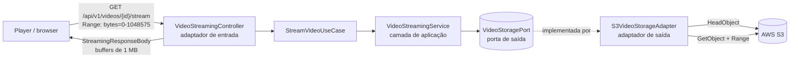

# Video Stream API

API de streaming de vídeo sobre **AWS S3** com **HTTP Range Requests**, entrega em **chunks de 1 MB**,
**arquitetura hexagonal** e **Spring Boot 3**.

O cliente (browser, player, app mobile) pede um trecho do vídeo com `Range: bytes=...`; a API consulta
o S3, abre **somente** o trecho pedido (`GetObject` com `Range`) e escreve a resposta em blocos de 1 MB,
sem nunca carregar o arquivo inteiro em memória.

---

## Stack

| Item | Versão |
|---|---|
| Java | 21 |
| Spring Boot | 3.5.16 |
| AWS SDK for Java | v2 (BOM 2.59.1) |
| Build | Maven (wrapper incluído) |
| Testes | JUnit 5, Mockito, AssertJ, MockMvc, ArchUnit |

---

## Como funciona



Fluxo de uma requisição:

1. O controller lê `Range` (e opcionalmente `If-Range`).
2. O caso de uso pede os metadados do vídeo: `HeadObject` no S3 (tamanho, `Content-Type`, `ETag`, `Last-Modified`).
3. `ByteRange.parse(...)` interpreta o cabeçalho, valida contra o tamanho real e **limita a faixa a
   `video.streaming.max-range-size`** (1 MB por padrão).
4. O adaptador chama `GetObject` com `Range: bytes=inicio-fim`; a AWS transfere só os bytes pedidos.
5. O controller responde `206 Partial Content` (ou `200` se a faixa cobrir o arquivo inteiro) com
   `Content-Range`, `Accept-Ranges`, `Content-Length`, `ETag` e `Last-Modified`.
6. O `StreamingResponseBody` copia do S3 para o socket em blocos de `video.streaming.chunk-size`,
   com `flush()` a cada bloco — memória constante (~1 MB por request) e início rápido da reprodução.

### Tabela de respostas

| Situação | Status | Cabeçalhos relevantes |
|---|---|---|
| Sem `Range` | `200 OK` | `Content-Length` = tamanho total, `Accept-Ranges: bytes` |
| `Range` satisfazível | `206 Partial Content` | `Content-Range: bytes 0-1048575/73400320` |
| `Range` inválido / fora do arquivo | `416 Range Not Satisfiable` | `Content-Range: bytes */73400320` |
| Vídeo inexistente | `404 Not Found` | corpo `ApiErrorResponse` (`VIDEO_NOT_FOUND`) |
| Id inválido (`../`, espaços, > 128 chars) | `400 Bad Request` | `INVALID_VIDEO_ID` |
| Falha no S3 (5xx, timeout, credencial) | `502 Bad Gateway` | `STORAGE_FAILURE` (detalhe só no log) |

### Requisição de exemplo

```http
GET /api/v1/videos/demo/stream HTTP/1.1
Range: bytes=0-
```

```http
HTTP/1.1 206 Partial Content
Accept-Ranges: bytes
Content-Range: bytes 0-1048575/73400320
Content-Length: 1048576
Content-Type: video/mp4
Content-Disposition: inline; filename="demo.mp4"
ETag: "9b2cf5..."
Last-Modified: Mon, 03 Feb 2026 10:15:30 GMT
X-Request-Id: 4f2b0c1e-...
```

> **Chunk de 1 MB:** `video.streaming.max-range-size` limita cada resposta. Um `Range: bytes=0-` recebe
> 1 MB e `Content-Range` indica o trecho entregue; o player continua com `bytes=1048576-`.
> Se preferir honrar o range inteiro pedido, configure `video.streaming.max-range-size: 0`
> (o `chunk-size` continua controlando o buffer de cópia).

---

## Estrutura do projeto

```
src/main/java/com/videostream/api
├── VideoStreamApiApplication.java
├── domain/                          # núcleo: Java puro, sem Spring/AWS
│   ├── model/                       #   VideoId, VideoMetadata, VideoSummary, ByteRange, VideoStream
│   ├── exception/                   #   VideoNotFoundException, InvalidRangeException, ...
│   └── port/VideoStoragePort.java   #   porta de saída (contrato com o storage)
├── application/                     # orquestração dos casos de uso
│   ├── port/in/                     #   StreamVideoUseCase, GetVideoMetadataUseCase, ListVideosUseCase, UploadVideoUseCase
│   └── service/                     #   VideoStreamingService, VideoService
├── adapter/
│   ├── in/web/                      # adaptador de entrada HTTP
│   │   ├── VideoController.java     #   POST /api/videos/upload (MultipartFile)
│   │   ├── VideoStreamingController.java
│   │   ├── dto/                     #   VideoMetadataResponse, VideoSummaryResponse, ApiErrorResponse
│   │   ├── mapper/VideoWebMapper.java
│   │   ├── support/ChunkedStreamCopier.java
│   │   ├── filter/CorrelationIdFilter.java
│   │   └── exception/GlobalExceptionHandler.java
│   └── out/s3/                      # adaptador de saída AWS S3 (SDK v2)
│       ├── S3VideoStorageAdapter.java
│       ├── S3StorageProperties.java
│       └── S3ClientConfiguration.java
└── config/                          # wiring e propriedades
    ├── UseCaseConfiguration.java
    ├── OpenApiConfiguration.java    #   Swagger UI / OpenAPI 3
    ├── WebConfiguration.java        #   CORS (expõe Content-Range/Accept-Ranges/ETag/Location)
    ├── VideoStreamingProperties.java
    └── CorsProperties.java
```

Regras de dependência são verificadas no build pelo **ArchUnit** (`HexagonalArchitectureTest`):

- `domain` não conhece Spring, AWS SDK, Jakarta ou Jackson;
- `application` não conhece adaptadores nem frameworks;
- `adapter.in.web` não conhece `adapter.out.s3` (e vice-versa);
- tudo que está em `..port..` é interface.

---

## Endpoints e Swagger UI

A documentação interativa (**Swagger UI**) fica disponível em:
- **Swagger UI:** `http://localhost:8080/swagger-ui.html`
- **OpenAPI JSON:** `http://localhost:8080/v3/api-docs`

| Método | Caminho | Descrição |
|---|---|---|
| `POST` | `/api/videos/upload` | Upload de vídeo (`multipart/form-data`, campo `file` e `id` opcional) |
| `GET` | `/api/v1/videos?limit=50` | Lista o catálogo (`limit` entre 1 e 100) |
| `GET` | `/api/v1/videos/{videoId}` | Metadados em JSON (`sizeBytes`, `etag`, `streamUrl`, ...) |
| `GET` | `/api/v1/videos/{videoId}/stream` | Streaming binário com suporte a `Range` e `If-Range` |

Exemplos:

```bash
# upload multipart de um vídeo para o S3 / LocalStack (201 Created)
curl -i -F "file=@demo.mp4" http://localhost:8080/api/videos/upload

# catálogo e metadados
curl http://localhost:8080/api/v1/videos
curl http://localhost:8080/api/v1/videos/demo

# arquivo inteiro (200)
curl -i http://localhost:8080/api/v1/videos/demo/stream -o demo.mp4

# primeiro chunk de 1 MB (206)
curl -i -H "Range: bytes=0-" http://localhost:8080/api/v1/videos/demo/stream

# bytes 2048-4095
curl -i -H "Range: bytes=2048-4095" http://localhost:8080/api/v1/videos/demo/stream

# últimos 100 KB
curl -i -H "Range: bytes=-102400" http://localhost:8080/api/v1/videos/demo/stream

# range fora do arquivo (416)
curl -i -H "Range: bytes=999999999-" http://localhost:8080/api/v1/videos/demo/stream
```

---

## Configuração

Todas as propriedades podem vir de `application.yml` ou de variáveis de ambiente.

| Propriedade | Env | Default | Descrição |
|---|---|---|---|
| `video.storage.bucket` | `S3_BUCKET` | `videos` | Bucket dos vídeos |
| `video.storage.region` | `AWS_REGION` | `us-east-1` | Região AWS |
| `video.storage.key-prefix` | `S3_KEY_PREFIX` | `videos/` | Prefixo das chaves (normalizado com `/`) |
| `video.storage.endpoint-override` | `S3_ENDPOINT` | vazio | Endpoint S3-compatible (LocalStack/MinIO) |
| `video.storage.path-style-access` | `S3_PATH_STYLE` | `false` | Path-style (necessário em LocalStack/MinIO) |
| `video.storage.chunked-encoding-enabled` | `S3_CHUNKED_ENCODING` | `true` | Desabilite em S3-compatible sem `aws-chunked` |
| `video.storage.access-key-id` / `secret-access-key` | — | vazio | **Só para desenvolvimento local**; em produção use a cadeia padrão (IAM Role/IRSA) |
| `video.streaming.chunk-size` | `STREAM_CHUNK_SIZE` | `1MB` | Buffer de leitura/escrita e tamanho do `flush` |
| `video.streaming.max-range-size` | `STREAM_MAX_RANGE_SIZE` | `1MB` | Tamanho máximo de uma resposta `206`; `0` = sem limite |
| `video.cors.allowed-origins` | `CORS_ALLOWED_ORIGINS` | `*` | Origens permitidas (lista separada por vírgula) |
| `spring.mvc.async.request-timeout` | — | `10m` | Tempo máximo de uma resposta em streaming |

Perfis: `local` aponta para o LocalStack em `http://localhost:4566` com path-style e credenciais de teste.

---

## Rodando localmente (LocalStack)

Pré-requisitos: JDK 21+, Docker e (opcional) AWS CLI ou `ffmpeg`.

```bash
# 1. sobe o LocalStack e cria o bucket "videos" (script em docker/localstack/init)
docker compose up -d

# 2. gera um vídeo de teste (requer ffmpeg) e envia para o bucket
ffmpeg -f lavfi -i testsrc=duration=60:size=1280x720:rate=30 -c:v libx264 -pix_fmt yuv420p demo.mp4
docker compose exec -T localstack awslocal s3 cp - s3://videos/videos/demo.mp4 < demo.mp4

# 3. sobe a API com o perfil local
./mvnw spring-boot:run -Dspring-boot.run.profiles=local
# Windows: .\mvnw.cmd spring-boot:run -Dspring-boot.run.profiles=local

# 4. teste o streaming
curl -i -H "Range: bytes=0-" http://localhost:8080/api/v1/videos/demo/stream
```

Com AWS real: configure `AWS_REGION`, `S3_BUCKET` e credenciais via IAM Role / `AWS_PROFILE`, sem
`endpoint-override` e com `path-style-access: false`.

---

## Testes

```bash
./mvnw test          # Windows: .\mvnw.cmd test
```

Cobertura por camada (90 testes, sem depender de Docker):

| Suíte | O que garante |
|---|---|
| `ByteRangeTest` | Parsing de `Range` (aberto, explícito, sufixo, multi-range), limites de 1 MB, 416 |
| `VideoIdTest` | Rejeição de path traversal e ids fora do padrão |
| `VideoStreamingServiceTest` | Orquestração, corte de chunk, propagação de 404/416 |
| `VideoStreamingControllerTest` | Contrato HTTP via MockMvc: 200/206/416/404/400, `If-Range`, DTOs, erros, correlation id |
| `VideoStreamingIntegrationTest` | Tomcat real + cliente HTTP real: status, `Content-Range`, `Content-Length` e bytes |
| `S3VideoStorageAdapterTest` | `HeadObject`/`GetObject` com `Range`, mapeamento de erros 404/416/5xx |
| `S3VideoStorageAdapterHttpTest` | AWS SDK real contra um S3 HTTP em processo: `HEAD`, `GET` com `Range`, 404 |
| `HexagonalArchitectureTest` | Regras de dependência entre domínio, aplicação e adaptadores |

---

## Decisões de projeto

1. **Hexagonal de verdade:** o domínio não importa Spring nem AWS SDK; `VideoStoragePort` é a única
   fronteira com o storage. Trocar S3 por GCS/MinIO significa escrever um novo adaptador.
2. **`HEAD` + `GET`:** o `HeadObject` fornece tamanho e validadores antes de abrir o stream, permitindo
   validar o range e responder `416` corretamente. São duas chamadas por request; o custo é baixo e o
   comportamento é previsível. (Otimização possível: um único `GET` lendo `Content-Range` da resposta.)
3. **`GetObject` com `Range` nativo:** a AWS transfere apenas os bytes do trecho; não há `skip()` de
   stream nem leitura desnecessária.
4. **1 MB por resposta (`max-range-size`) e 1 MB de buffer (`chunk-size`):** memória constante,
   `flush` por bloco e progressão previsível. `max-range-size: 0` desabilita o corte para players que
   exigem o range completo.
5. **`StreamingResponseBody` + virtual threads:** a cópia bloqueante acontece em thread virtual
   (`spring.threads.virtual.enabled=true`), sem esgotar o pool do Tomcat.
6. **Sem compressão HTTP:** `server.compression.enabled=false`. Gzip quebraria `Content-Length`/
   `Content-Range` e gastaria CPU com vídeo já comprimido.
7. **`Content-Disposition: inline` + `Content-Type` real:** o browser toca no próprio player; o
   `Content-Type` vem do S3 e, se ausente, é inferido pela extensão.
8. **`If-Range` e `ETag`:** se o validador não confere, o `Range` é ignorado e o arquivo inteiro é
   devolvido (RFC 9110), evitando montar vídeo corrompido a partir de versões diferentes.
9. **Erros sem vazamento:** `GlobalExceptionHandler` traduz exceções em `ApiErrorResponse`
   (`code`, `message`, `path`, `correlationId`, `fieldErrors`); detalhes de infraestrutura só no log.
10. **`X-Request-Id`:** aceito do cliente ou gerado, colocado no MDC e ecoado na resposta.
11. **CORS expondo `Content-Range`/`Accept-Ranges`/`ETag`:** sem isso players web não fazem seek.
12. **Id sanitizado no domínio:** `VideoId` impede `../`, barras e ids longos demais, protegendo a
    composição da chave do objeto.
13. **ArchUnit no build:** a arquitetura é executável, não apenas um desenho no README.

---

## Produção: checklist

- **Não exponha o bucket:** mantenha-o privado. Para usuários finais, prefira **CloudFront com URLs
  assinadas** (ou pre-signed URLs de curta duração); esta API é o caminho quando você precisa de
  autorização/contabilização por request.
- **Autenticação/autorização:** adicione Spring Security (JWT/OAuth2) ou valide no API Gateway.
  O endpoint atual não tem autenticação por design (escopo do exercício).
- **Rate limiting e quotas:** no gateway (WAF/API Gateway) ou com Bucket4j.
- **Observabilidade:** Micrometer + OpenTelemetry; métricas de latência, bytes servidos, 4xx/5xx e
  chamadas ao S3.
- **Timeouts e pool:** ajuste `ClientOverrideConfiguration` (API call timeout) e o pool do Apache
  HttpClient conforme a latência do S3; o `S3Client` é singleton e thread-safe.
- **Custo:** cada request faz `HEAD` + `GET`; para catálogos grandes, cache de metadados (Caffeine/Redis).
- **S3:** habilite SSE (SSE-S3/KMS), versionamento e lifecycle (Glacier para arquivo morto); considere
  `Cache-Control` na resposta para CDN.
- **Shutdown graceful:** já configurado (`server.shutdown: graceful`); o `destroyMethod` fecha o
  `S3Client` e devolve as conexões.
- **Teste de carga:** valide o throughput com muitos ranges simultâneos (k6/Gatling).

## Limitações conhecidas

- **Multi-range** (`bytes=0-99,200-299`) não é suportado: apenas a primeira faixa é servida (documentado).
- **`HEAD`** é tratado pelo Spring MVC a partir do `GET` (o corpo é descartado), mas o stream ainda é aberto.
- **Sem autenticação** e sem catálogo persistido: o catálogo é uma listagem do bucket (`ListObjectsV2`).
- **Sem cache de metadados**: cada request de streaming faz um `HEAD`.
